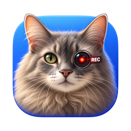

<p align="center">
  
</p>

<h1 align="center">TedCat for Windows</h1>

<p align="center">Hold to screenshot. Shift-hold to record an area. One tray item to record the computer's audio.</p>

<p align="center">
  <a href="https://github.com/irobson/tedcat-win/releases/latest"><b>Download the latest TedCat.exe</b></a>
</p>

[](https://github.com/irobson/tedcat-win/actions/workflows/ci.yml)


[](LICENSE)

A tiny native Windows tray app, the Windows sibling of [TedCat for macOS](https://github.com/irobson/tedcat).

| How                                       | Result                                                   |
|-------------------------------------------|----------------------------------------------------------|
| **Hold** the left button, drag, release   | Screenshot of the area, copied to the clipboard          |
| **Shift + Hold**, drag, release           | Video of the area with the computer's audio, saved as MP4 |
| Tray icon › **Record Audio Only**         | The computer's audio only, saved as M4A                  |

No hotkey to remember, no installer, no account, no network access.

## Features

- **Press-and-hold to capture.** Hold the left mouse button still for a moment anywhere, then drag out the area you want.
- **Screenshots straight to the clipboard,** as an image and as PNG, so they paste into Paint, Word, browsers, Slack, Teams and Discord. Nothing is written to disk.
- **Area screen recording** with the computer's audio, saved automatically as an H.264 MP4 at the screen's native resolution (areas larger than 4096 x 2304, such as a full 5K screen, are scaled down to fit H.264).
- **Audio-only recording** of everything the computer plays, such as the other people in a Zoom, Meet or Teams call. Handy for meeting notes and transcription.
- **Discreet controls.** A red outline marks the recorded area; a small pill with a timer sits in the screen corner farthest from it. One click stops and saves.
- **A card after every recording** with the file name, folder, size, length and a thumbnail. Click to play, drag the thumbnail into another app, or show it in Explorer.
- **Clean output.** TedCat's own overlay, outline, pill and card never appear in screenshots or videos.
- **Ordinary clicks keep working.** Quick clicks, double clicks, drags, Ctrl/Shift-clicks and right clicks reach your apps as usual, with Ctrl, Shift, Alt and Win where you pressed them. Left-handed (swapped) mouse buttons are supported.
- **Light.** One small executable, no dependencies, no background services.

## Install

1. Open the [latest release](https://github.com/irobson/tedcat-win/releases/latest) and download **TedCat-x.y.z-windows-x64.exe**.
2. Put it anywhere, for example in a `TedCat` folder in your user folder, and double-click it.
3. Windows SmartScreen may say the app is unrecognized, because it is not code-signed yet. Click **More info**, then **Run anyway**.
4. Ted appears in the tray, near the clock. If you do not see him, click the **^** arrow and drag him onto the taskbar.

To start TedCat automatically, enable **Launch at Login** in its tray menu.

Requirements: Windows 10 version 2004 or later, or Windows 11, 64-bit. ARM64 PCs run it through Windows' x64 emulation.
TedCat needs no special permission on Windows.

## Use it

### Screenshot

1. Press the left mouse button and keep it **still** for about a third of a second. (With the buttons swapped for left-handed use, hold your primary button, the right one.)
2. The screen dims. Drag to size the area; a label shows its size. Press **Esc** to cancel.
3. Release. The area flashes and the image is on the clipboard. Paste it with **Ctrl+V**.

### Record an area

1. Hold **Shift**, press the left button and keep it still for the same moment.
2. The label reads **● REC · drag to select an area**. You can let go of Shift now.
3. Drag to size the area. The frame turns red. Release, and recording starts.
4. A red outline marks what is recorded; a pill with a timer appears in a screen corner.
5. Click the pill, or choose **Stop Recording** in the tray menu, to stop. The file is saved and a card shows where.

Releasing without dragging, or on an area too small to film, does nothing.

If the display resolution or orientation changes while recording, TedCat stops the recording and keeps what it recorded until then. If you sign out, restart or shut down while recording, TedCat saves the recording first; Windows shows "Saving a recording" for TedCat on its shutdown screen meanwhile.

### Record audio only, for example a meeting

1. Click Ted in the tray and choose **Record Audio Only**.
2. The pill appears in the bottom-right corner with a red waveform and a timer.
3. Click the pill, or choose **Stop Recording**, to stop.

TedCat records what the computer plays: the other people in a call, a video, a podcast. It works with headphones too. **Your own microphone is not recorded.**

### Where files go

Recordings are saved to `Videos\TedCat` with names like `TedCat 2026-10-30 at 14.03.22.mp4`, or `.m4a` for audio only. Change the folder from the tray menu.

| Recording   | Format |
|-------------|--------|
| Video       | H.264 in MP4, native resolution up to 4096 x 2304 (larger areas are scaled down), 30 fps, 2 to 9 Mbps depending on the area |
| Video audio | AAC, 48 kHz stereo, 128 kbps |
| Audio only  | AAC in M4A, 48 kHz stereo, 128 kbps, about 1 MB per minute |

To convert a recording for a transcription tool such as Whisper:

```powershell
ffmpeg -i "TedCat 2026-10-30 at 14.03.22.m4a" -ac 1 -ar 16000 audio.wav
```

## Tray menu

| Item | What it does |
|------|--------------|
| Record Audio Only / Stop Recording | Start an audio-only recording, or stop the current recording |
| Enabled | Turns the hold gesture on or off. When off, TedCat never touches a click |
| Trigger | Hold only, or require Ctrl, Alt or Win together with the hold. Shift is reserved for recording |
| Hold Duration | 200, 350, 500 or 750 ms |
| Play Sounds | Short system sounds on screenshot and on recording start and save |
| Launch at Login | Start TedCat when you sign in |
| Include System Audio in Videos | Add the computer's audio to area recordings |
| Open Recordings Folder / Change Recordings Folder… | Where recordings are saved |
| Open Log File | TedCat's log, useful when something does not work |
| Quit TedCat | Stops TedCat; a running recording is saved first, and a press TedCat is holding goes back to the app |

Settings are stored in `%APPDATA%\TedCat\settings.json`.

## Safety: your clicks always keep working

To tell a hold from a click, TedCat briefly holds back each left-button press and hands it back to the app underneath if you release or move. If anything goes wrong, TedCat is designed to stop intercepting rather than to lose clicks:

- If Windows refuses to hand a click back, TedCat turns the gesture off at once and tells you.
- If you press or release Shift, Ctrl, Alt or Win while holding the button and then type, scroll or press another button, TedCat hands the press back at once, so everything reaches the app in the order you did it.
- While TedCat quits or Windows signs you out, it holds no new presses; a selection on screen is closed and its press handed back to the app.
- Clicks on windows of programs running as administrator are never held, because Windows would not let TedCat hand them back.
- Clicks on TedCat's own pill and card are never held.
- If Windows removes TedCat's input hook, it notices and reinstalls it cleanly.
- Only one TedCat can run at a time.
- **Emergency switch:** press **Esc three times quickly** and the gesture turns off. Turn it back on with **Enabled** in the tray menu.

If clicks ever misbehave, press Esc three times, or end TedCat from Task Manager (Ctrl+Shift+Esc).

## Troubleshooting

**A yellow border appears around the screen while recording.**
Windows draws it during screen capture. TedCat always asks Windows to leave it off. Windows 11 does so when desktop apps are allowed to turn the screenshot border off (Settings › Privacy & security › Screenshot borders, on versions that have that page); Windows 10 always shows the border. The border is not part of the video.

**Recording says "Recording needs Windows Media Foundation (install the Media Feature Pack)."**
Windows "N" and "KN" editions ship without media components. TedCat still starts there, and the hold gesture and screenshots work; only recording needs them. Install the **Media Feature Pack** from Optional features in Settings (search Settings for "Optional features", then View features / Add a feature), restart Windows if it asks, and record again.

**Recordings have no sound.**
TedCat records the default playback device. Check that a playback device exists and that **Include System Audio in Videos** is on.

**Nothing happens when I hold the button.**
Check **Enabled** in the tray menu, and whether a **Trigger** key is required. Open the log file from the tray menu for details.

## Build from source

On Windows with the Rust toolchain (MSVC):

```powershell
cargo test --workspace
cargo build --release -p tedcat
```

The executable is `target\release\TedCat.exe`. You can also cross-compile from macOS or Linux with the `x86_64-pc-windows-gnu` target and mingw-w64.

Releases are built by GitHub Actions: pushing a tag such as `v0.1.0` that matches the version in `Cargo.toml` builds, tests and publishes `TedCat.exe` on the Releases page. Every push runs the unit tests and an end-to-end smoke test that drives TedCat.exe on a Windows runner with simulated mouse input.

How it works inside: [docs/ARCHITECTURE.md](docs/ARCHITECTURE.md).

## License

MIT. See [LICENSE](LICENSE).
